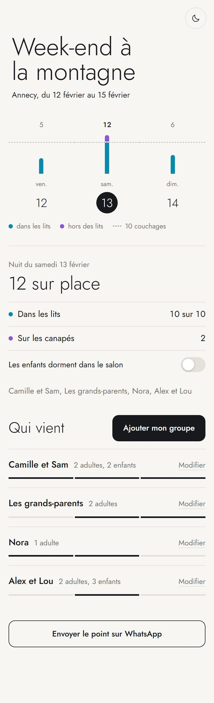

# Qui vient quand

Une page à partager dans un groupe WhatsApp pour organiser un séjour à plusieurs : chacun coche les nuits où il vient, et tout le monde voit combien de lits il reste.

Pensée pour un week-end entre amis, des vacances en famille, un mariage sur deux jours, une maison louée à plusieurs.



- **Sans compte ni mot de passe** pour les invités : ils ouvrent le lien, écrivent leur prénom, touchent leurs nuits.
- **Le compte se fait tout seul** : lits pris, lits libres, personnes en plus sur les canapés, enfants au dortoir.
- **Qui dort où** : chacun l'écrit directement sur la pièce.
- **Un bouton WhatsApp** envoie le point nuit par nuit au groupe.
- **Gratuit** : l'app tourne sur l'offre gratuite de Cloudflare, sur votre propre compte. Vos données restent chez vous.

## Le plus simple : demandez à une IA de l'installer

Copiez ce texte dans **Claude Code** ou **Codex**, et répondez à ses questions :

```text
Installe pour moi l'app « Qui vient quand » : https://github.com/Melpopytips/qui-vient-quand

Récupère le dépôt, lis son fichier AGENTS.md et suis-le pas à pas : pose-moi les questions sur mon évènement, remplis les réglages, mets l'app en ligne sur Cloudflare (gratuit) et donne-moi le lien à partager.

Je ne suis pas développeur : explique-moi simplement ce que je dois faire moi-même, et fais le reste.
```

Ce qu'il vous faut :

- **Un outil qui peut agir sur votre ordinateur** : Claude Code (l'onglet « Code » de l'application Claude pour ordinateur, ou le terminal) ou Codex. Une simple conversation sur claude.ai ou ChatGPT ne suffit pas : elle peut vous expliquer les étapes, pas les faire.
- **Un compte Cloudflare gratuit.** L'IA vous dira quand vous connecter. Aucune carte bancaire n'est demandée.
- **Node.js** sur l'ordinateur. Si vous ne l'avez pas, l'IA vous guide.

Comptez une dizaine de minutes, surtout pour répondre aux questions.

## À la main

Pour celles et ceux qui préfèrent le faire eux-mêmes. Il faut [Node.js](https://nodejs.org) 20 ou plus.

1. Récupérez le dépôt (`git clone`, ou le bouton « Code » puis « Download ZIP »).
2. Ouvrez `evenement.json` et remplacez l'exemple par votre évènement. Le détail de chaque réglage est dans [AGENTS.md](AGENTS.md).
3. Donnez un nom au site dans `wrangler.jsonc` (champ `name`).
4. Dans le dossier, lancez :

   ```bash
   npx wrangler@4 login
   npx wrangler@4 deploy
   ```

5. Ouvrez l'adresse affichée. La première visite crée la clé d'accès et vous montre **le lien à partager**. Faites cette visite vous-même, tout de suite.

Pour essayer sans rien mettre en ligne : `npx wrangler@4 dev`.

## Les réglages

Tout tient dans `evenement.json` :

```json
{
  "nom": "Week-end à la montagne",
  "lieu": "Annecy",
  "premiere_nuit": "2027-02-12",
  "nombre_de_nuits": 3,
  "couchages": 10,
  "appoint": "sur les canapés",
  "dortoir_enfants": { "lieu": "dans le salon", "nuits": [] },
  "pieces": [{ "nom": "Chambre 1", "detail": "1 lit double" }],
  "infos": [{ "titre": "Arrivée", "texte": "Vendredi, à partir de 17 h." }],
  "photos": [],
  "couleur": "#0b89ad"
}
```

Pour changer quelque chose plus tard, modifiez le fichier et relancez `npx wrangler@4 deploy`. Les réponses déjà saisies sont gardées.

Pour les photos, utilisez les vôtres : celles d'une annonce de location appartiennent à son propriétaire.

## Qui peut voir quoi

Le lien contient une clé. **Le lien est la clé** : quiconque l'a peut voir et modifier toutes les réponses. Partagez-le dans votre groupe, pas en public.

- Sans la clé, ni la page ni les données ne sont accessibles. Les fichiers rangés dans `public/` (police, photos) restent, eux, visibles par qui en connaît l'adresse exacte.
- La page demande aux moteurs de recherche de ne pas la référencer.
- L'app ne dépose aucun cookie et n'appelle aucun service extérieur. Les prénoms et les nuits cochées sont enregistrés dans la base de votre compte Cloudflare, nulle part ailleurs. Cette base est créée près de l'endroit d'où vous mettez en ligne : en Europe si vous êtes en Europe.
- Si le lien a fuité, on change la clé en deux commandes (voir [AGENTS.md](AGENTS.md)).
- Après le séjour, supprimez le site et sa base : ces données n'ont plus de raison d'exister.

## Ce que l'app ne fait pas

- Elle organise des **nuits**. Pour une soirée sans couchage, un simple sondage suffit.
- Il n'y a pas de rôles : tous ceux qui ont le lien ont les mêmes droits. Si deux personnes modifient le même groupe au même moment, la dernière saisie l'emporte.
- Pas de repas, de courses, de covoiturage ni de partage des frais.
- L'interface est en français.

## D'où ça vient

Cette app a été faite pour un vrai séjour en famille, et pour la question que tout le monde posait : « il reste de la place samedi ? ».

Par [Mélanie Chenavard](https://github.com/Melpopytips). Licence MIT : utilisez-la, modifiez-la, partagez-la. La police Jost (dossier `public/fonts`) est sous licence SIL Open Font License.
